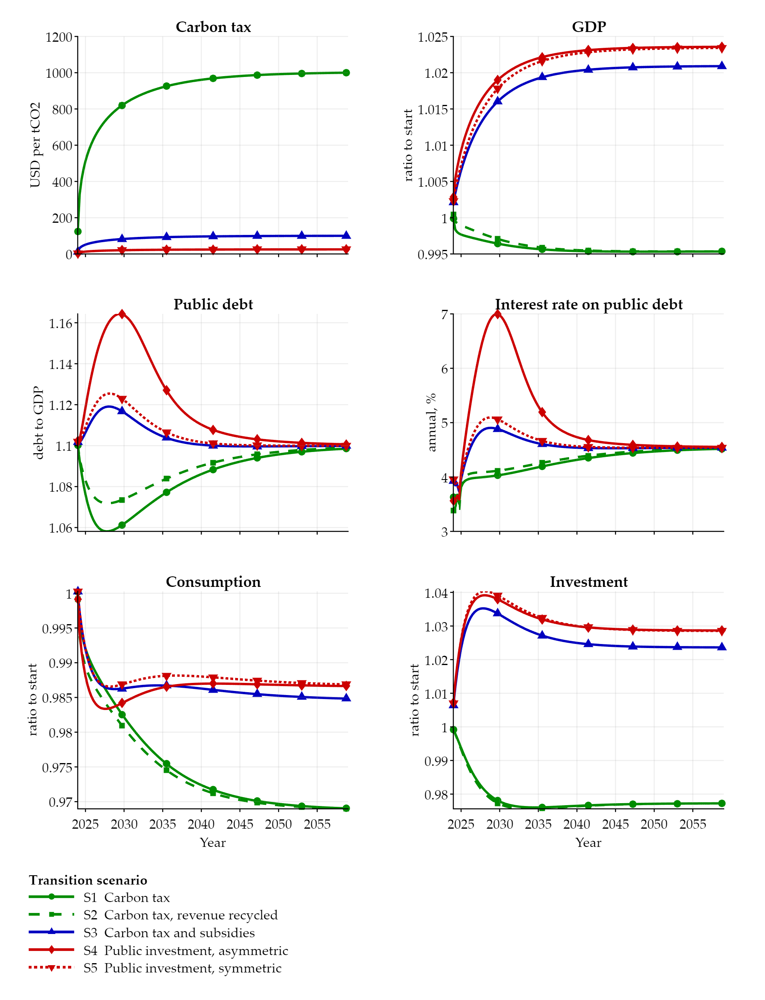

# Climate Change and Sovereign Debt Sustainability

Master's thesis, Université Paris Dauphine-PSL, 2026.
Author: Alexandre Saint. Supervisors: Anne-Laure Delatte and Loïc Henry.

The full text is in [`thesis/`](thesis/Saint_2026_Climate_Change_Sovereign_Debt.pdf).
This repository holds the model and the code that produce every model-based figure of the
thesis.

## Abstract

We analyze the link between climate change and debt sustainability in France within a
dynamic general equilibrium (DGE) model, in order to simulate the economic dynamics resulting
from the shock represented by the net-zero transition. We replicate the model of Seghini and
Dees (2025), a DGE model that includes the green transition, climate damages and a fiscal
block, and add the damage function found in Bilal and Känzig (2026), on the upper end of the
damage spectrum found in the literature. We find that in the case of ambitious mitigation
objectives, relying solely on public money to finance the transition can prove risky, due to
the difference between public and private mitigation cost structures. The physical damages
produced by climate change, in addition to reducing GDP, exacerbate the fiscal stress that may
arise from government-funded transition policies, with the peak annual default probability
rising from about 12% to above 20% in the worst case scenario. The cost to output, alongside
consumption and investment, rises greatly under 3 °C, with losses of about a third of output
under the most severe damage specification, that of Bilal and Känzig.

*Note on this version.* The PDF in `thesis/` is a revised version of the thesis submitted in
September 2026. Figures 4 to 8 were regenerated with the code of this repository, so that every
simulation uses the same fiscal-rule inertia (0.904) and the Bilal and Känzig parameters stated
in the text; the numbers quoted from these figures were updated accordingly, and a short
paragraph in Section 3.2.4 now states how the fiscal rule is implemented. The qualitative
conclusions are unchanged; the losses attributed to the Bilal and Känzig specification are smaller than in the submitted
version (about a third of output at 3 °C instead of half).

## What is replicated and what is added

**Replication.** The model is a reimplementation in Dynare of the dynamic general equilibrium
(DGE) model of Seghini and Dees, *The Green Transition and Public Finances* (Banque de France
Working Paper 949, 2024; published in *Macroeconomic Dynamics*, 2025). A national carbon
budget sets the abatement path to net zero; abatement is paid by firms, subsidised, or
carried out by the government; public debt feeds a sovereign default probability through a
stochastic fiscal limit, which in turn sets the interest rate on public debt. The five policy
scenarios of the paper are reproduced for France (Figures 4 and 5 of the thesis). The code was
written from the published equations; it does not contain the authors' code.

**Extension.**

- Five climate damage specifications on a common temperature scale, normalised so that every
  economy starts from the same observed output: DICE-2023 (Barrage and Nordhaus), Kalkuhl and
  Wenz (2020), Seghini and Dees (2025), Seghini, Dees and De Gaye (2026), and Bilal and Känzig
  (2026).
- The Bilal and Känzig damage function, whose effect on productivity depends on the whole
  history of warming, written in recursive form with two exponentially weighted memories of
  past temperature so that it fits a perfect-foresight DGE model (derivation in Appendix A of
  the thesis).
- A 3 °C world (world carbon budget of 3055 GtCO2) next to the 1.5 °C world of the paper.
- Every simulation uses a fiscal-rule inertia of 0.904, the highest value at which all 60
  configurations have a solution (at 0.905, public investment with asymmetric costs under the
  Bilal and Känzig damage has none).

Departures from the published paper: a discount factor of 0.995 (consistent with the bond
rate of the paper's figures), a tax target in the fiscal rule that moves from the initial to
the final tax rate in step with abatement (Section 3.2.4 of the thesis), and the CO2-only
carbon clock of Seghini, Dees and De Gaye (2026).

## How to run

Requirements: MATLAB (tested on R2025b) and [Dynare](https://www.dynare.org) 7.1.

```matlab
addpath('C:\dynare\7.1\matlab')   % path to your Dynare installation
run('run_all.m')                  % from the repository root
```

`run_all.m` solves the 60 configurations (5 policy scenarios x 6 damage settings x 2 carbon
budgets), saves the paths to `output/results.mat`, draws Figures 3 to 8 into `figures/` and
prints the headline numbers of every run. It takes about five minutes on a laptop.

A single configuration can be solved directly:

```matlab
cd model
dynare sd24_climate_debt.mod -Dscenario=4 -Ddamage=5 -Dworld=1
```

with `scenario` 1 to 5, `damage` 0 (none) to 5 (Bilal and Känzig) and `world` 1 (1.5 °C) or
2 (3 °C), as documented at the top of the model file.

## Structure

```
run_all.m                     entry point
model/
  sd24_climate_debt.mod       the model (equations, calibration, transition)
scripts/
  run_scenarios.m             solves the 60 configurations with Dynare
  make_figures.m              draws Figures 3 to 8 from the saved results
  summarize_runs.m            debt peak, default peak and output loss of every run
  plot_lib.m, plot_style.m    figure layout, colours and line styles
  pick_run.m, series_of.m     access to the saved runs
figures/                      the figures of the thesis, as produced by run_all.m
thesis/                       the thesis (PDF)
```

## Figures

| Thesis | File | Content |
|---|---|---|
| Figure 3 | `fig3_damage_shapes.png` | The five damage specifications as functions of warming |
| Figure 4 | `fig4_macro_financial.png` | Macro-financial effects of the five policies, 1.5 °C world, no damage |
| Figure 5 | `fig5_default_probability.png` | Annual default probability, same runs |
| Figure 6 | `fig6_policy_two_worlds.png` | The five policies in the 1.5 °C and 3 °C worlds, no damage |
| Figure 7 | `fig7_damage_zoom_1p5C.png` | Output, debt and default under each damage specification, 1.5 °C |
| Figure 8 | `fig8_damage_gdp_3C.png` | GDP under each damage specification, carbon tax scenario, 3 °C |

Figures 1 and 2 of the thesis describe observed data (warming, disasters, public finances)
and are not produced by this code.



## Credits

- Model: C. Seghini and S. Dees, *The Green Transition and Public Finances*, Banque de France
  Working Paper 949 (2024), *Macroeconomic Dynamics* (2025). Carbon clock and damage severity
  from C. Seghini, S. Dees and A. De Gaye, *Under Pressure: Sovereign Debt Challenges in a
  Warming World*, Banque de France, unpublished working paper (2026).
- Two-kernel damage function: A. Bilal and D. R. Känzig, *The Macroeconomic Impact of Climate
  Change: Global versus Local Temperature*, *Quarterly Journal of Economics* (2026). The kernel
  parameters were provided by Diego Känzig through Caterina Seghini.
- Other damage functions: L. Barrage and W. Nordhaus, DICE-2023, *PNAS* (2024); M. Kalkuhl and
  L. Wenz, *Journal of Environmental Economics and Management* (2020).
- Supervision: Anne-Laure Delatte and Loïc Henry (Université Paris Dauphine-PSL).

## Limitations

This is a master's thesis: the simulations are deterministic (perfect foresight), and the
model is calibrated, not estimated.
